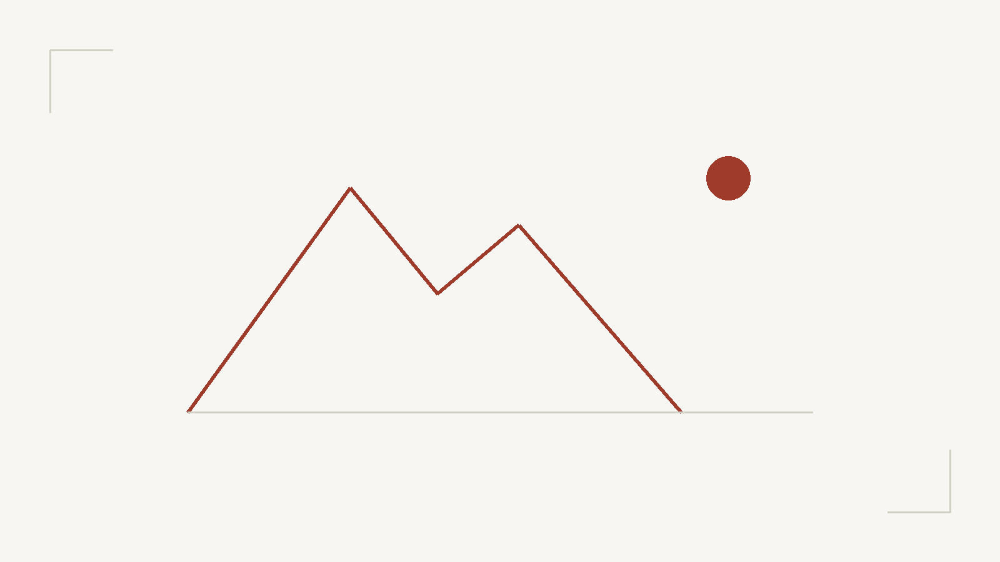

This post exists to check the layout. Replace the sample files in `src/content/posts/` with your own before going live.

## Paragraphs

Body text is capped at roughly 72 characters per line, with a line height of 1.75. The space between paragraphs is larger than the leading, which makes it easier to find the start of the next paragraph. You can use **bold**, *emphasis*, `inline code`, and [internal links](/posts/).

## Lists

- The first item, long enough to wrap and show the hanging indent
- The second
- The third

1. Write Markdown locally
2. Build
3. Push to the main branch

## Tables

| Item | Value | Note |
| --- | --- | --- |
| Content width | 72ch | Maximum line length |
| Body size | 17px | 16px on mobile |
| Line height | 1.75 | Paragraphs spaced further |
| Breakpoints | 640 / 1024 | Based on crowding, not devices |

## Quotes and callouts

> A quote for excerpts or emphasis. Hierarchy comes from indentation and the left rule, not from italics.

> [!NOTE]
> Callouts are generated at build time from `> [!NOTE]`. Five types are supported: NOTE, TIP, IMPORTANT, WARNING, CAUTION.

> [!WARNING]
> Callout colours are defined for both themes, so switching theme updates them without extra work.

## Code

File name and line numbers are both optional:

```ts title="src/utils/sample.ts" lineNumbers
export function greet(name: string): string {
  return `Hello, ${name}!`;
}

const message = greet("world");
console.log(message);
```

Without a title, only the language is shown:

```bash
pnpm install
pnpm dev
```

## Images

Body images are lazy-loaded and open in a lightbox with keyboard navigation:



## Footnotes

Footnotes keep asides out of the main flow.[^1]

[^1]: This is a sample footnote. Clicking the number returns to the text.
